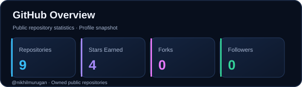
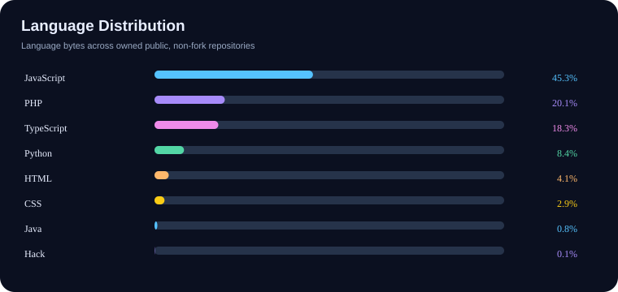
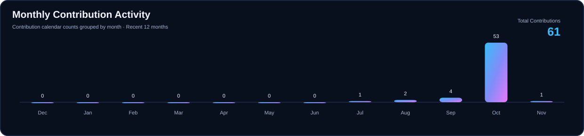

 

 

## 👨‍💻 About Me

MCA student at **VIT Vellore**, interested in software development, artificial intelligence, cloud computing, and modern application development. I enjoy building practical applications, exploring emerging technologies, and solving problems through code.

## ⚙️ Technical Expertise

<table>
<tr>
<td width="50%" valign="top">

**Programming Languages**

**Web & Backend**

</td>
<td width="50%" valign="top">

**AI & Machine Learning**

**Cloud, Database & Tools**

</td>
</tr>
</table>

## 📊 GitHub Analytics

<table>
<tr>
<td width="50%" valign="top">

</td>
<td width="50%" valign="top">

</td>
</tr>
<tr>
<td colspan="2" align="center">

</td>
</tr>
</table>

## 🚀 Explore My Work

Explore my repositories, projects, and technical experiments.

---

**Let's build, learn, and innovate.**

