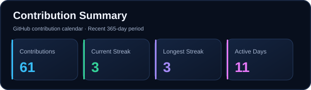

# Nikhil Murugan D P

  

  <a href="https://portfolio-nikhil-two.vercel.app/">Portfolio</a> •
  <a href="https://www.linkedin.com/in/nikhil-murugan-d-p-934b3a3ab">LinkedIn</a> •
  <a href="https://leetcode.com/u/Nikhil_-24/">LeetCode</a> •
  <a href="https://www.kaggle.com/nikhilmurugandp">Kaggle</a>

## About Me

MCA student at VIT Vellore with an interest in software development, artificial intelligence, cloud computing, and modern application development. I enjoy building practical applications, exploring emerging technologies, and solving problems through code.

## Technical Expertise

- **Languages:** Java, Python, C, C++, JavaScript, PHP, Dart, SQL
- **Web Development:** React, Angular, Node.js, Express.js, Spring Boot, Flask, HTML, CSS, Tailwind CSS
- **AI & Machine Learning:** Machine Learning, Deep Learning, Predictive Analytics, TensorFlow, Scikit-learn, LLMs, RAG, Agentic AI
- **Databases & Cloud:** MySQL, MongoDB, Supabase, AWS, Firebase
- **Tools:** Git, GitHub, VS Code, Docker, Postman, Figma, Android Studio

## GitHub Analytics

  

  

  

  

  Analytics generated from public GitHub data and updated daily using GitHub Actions.

## Education

**Master of Computer Applications (MCA)**  
Vellore Institute of Technology, Vellore | 2025–2027

**Bachelor of Computer Applications (BCA)**  
Vellore Institute of Technology, Vellore | 2022–2025

## Explore My Work

Explore my repositories for projects, experiments, and development work.

  

## Let's Connect

  
  
  

  Building, learning, and improving — one commit at a time.

